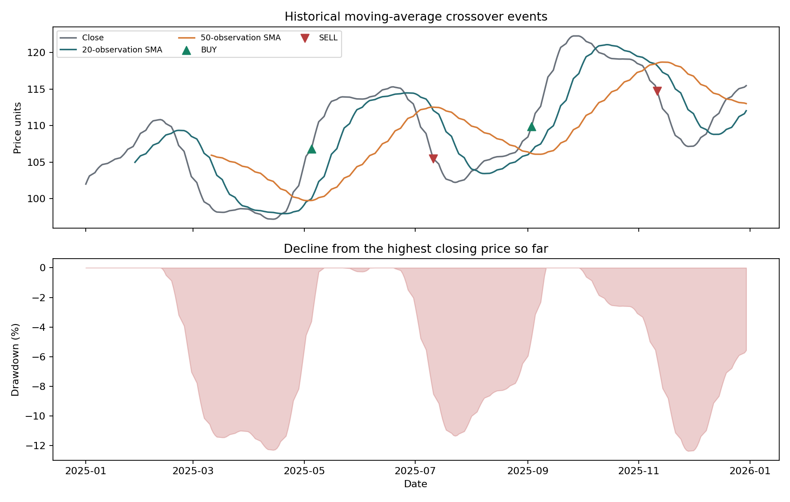

# Stock Market Indicators with Python

A time-series analysis pipeline for moving averages, daily returns, volatility, drawdown, and historical BUY/SELL crossover events. Trailing windows use only the current observation and earlier prices.

## Results

| Measure | Result |
|---|---:|
| Observations | 260 |
| Historical BUY / SELL events | 2 / 2 |
| Closing-price return | 13.20% |
| Annualized daily volatility | 6.99% |
| Maximum drawdown | -12.36% |

Results describe the **simulated DEMO price series**. The 13.20% price change is the input series' return, not the return of a crossover strategy. [View the example report](docs/example-report.md).

## Methodology

~~~text
daily return = current close / previous close − 1
n-observation SMA = mean of the latest n closing prices
cumulative price return = current close / first close − 1
drawdown = current close / highest close so far − 1
annualized volatility = sample standard deviation of daily returns × √252
~~~

Default moving-average windows are 20 and 50 observations. The annualization convention assumes daily data and approximately 252 trading observations per year. Rolling volatility uses 20 valid daily returns.

| Event | Condition |
|---|---|
| BUY | Fast SMA moves from at or below the slow SMA to strictly above it. |
| SELL | Fast SMA moves from at or above the slow SMA to strictly below it. |
| NONE | No new crossover, including the warm-up period. |

Events require two consecutive valid SMA comparisons. The first complete pair of averages does not automatically create a signal. A crossover is known only after the current closing price becomes available.

## Dataset

[demo_prices.csv](data/demo_prices.csv) contains 260 simulated weekday observations for a fictional asset. [make_demo_data.py](make_demo_data.py) reproduces the series using a trend and smooth cycles.

| Field | Description |
|---|---|
| date | Observation date in YYYY-MM-DD format |
| close | Positive closing price in arbitrary price units |
| volume | Simulated units traded; retained but unused in the indicators |

The data does not represent an actual company or exchange. Exchange holidays are not modeled.

## Installation and usage

Requires **Python 3.11–3.13**.

~~~bash
git clone https://github.com/Farscent/stock-market-indicators.git
cd stock-market-indicators
python -m venv .venv
~~~

Activate the environment with <code>.\.venv\Scripts\Activate.ps1</code> on Windows PowerShell or <code>source .venv/bin/activate</code> on macOS/Linux.

~~~bash
python -m pip install -r requirements.txt
python indicators.py
python indicators.py --fast 10 --slow 30
~~~

The included data runs offline after dependency installation.

## Custom price data

Supply a daily CSV for one asset containing date and close columns. The default settings require at least 51 observations.

~~~bash
python indicators.py --input data/my_prices.csv --output outputs/my_asset
~~~

Dates are sorted. Duplicate dates, missing or nonpositive prices, and infinite values are rejected. Prices are not forward-filled.

A real dataset should document its source, download date, currency, frequency, and split/dividend adjustment method. A consistent price basis is necessary to avoid artificial jumps from corporate actions.

## Outputs

| File | Contents |
|---|---|
| outputs/indicators.csv | Prices, averages, returns, risk measures, and events |
| outputs/crossovers.csv | Dates with a new BUY or SELL event |
| outputs/summary.json | Period statistics and event counts |
| outputs/report.md | Written summary |
| outputs/market_overview.png | Price/average chart and drawdown chart |

## Limitations

Moving averages lag prices and can produce repeated signals in sideways markets. BUY and SELL labels are historical technical events, not recommendations or executed trades.

This project does not model execution, fees, slippage, position sizing, or strategy returns. Closing-price returns exclude cash dividends and trading costs. Volatility annualization depends on the observation frequency, and the simulated series cannot establish real-market profitability.

## Notebook

[View the analysis notebook](walkthrough.ipynb) for intermediate tables, visualizations, and saved outputs. To run it locally:

~~~bash
python -m pip install -r requirements-notebook.txt
python -m notebook walkthrough.ipynb
~~~

## Validation

Tests cover hand-calculated crossovers, warm-up behavior, constant prices, invalid inputs, and report generation. A separate check confirms that changing future prices does not alter past indicators. CI also reproduces the dataset and executes the notebook.

~~~bash
python -m unittest discover -s tests -v
~~~

GitHub Actions runs the checks on Python 3.11 and 3.12. The project has also been verified on Windows with Python 3.13.

## References

- [Fidelity: Simple Moving Average](https://www.fidelity.com/learning-center/trading-investing/technical-analysis/technical-indicator-guide/sma)
- [pandas rolling windows](https://pandas.pydata.org/docs/reference/api/pandas.DataFrame.rolling.html)

## License

Code and synthetic demonstration data are available under the [MIT License](LICENSE).
